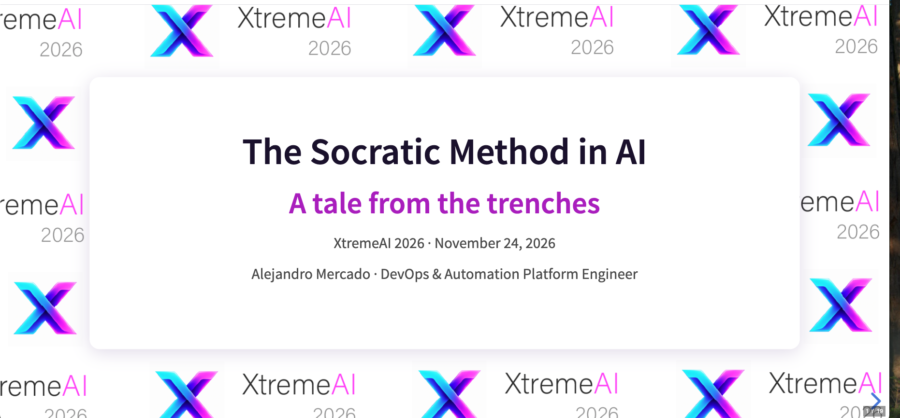
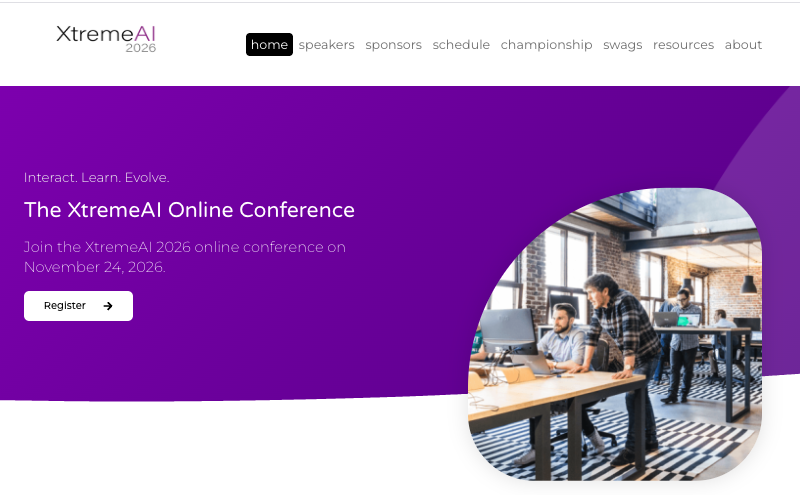

  

# The Socratic Method in AI: a Tale from the Trenches

**XtremeAI 2026 · online conference · Tuesday, November 24, 2026 · 06:35 GMT**
Speaker: **Alejandro Mercado** (IBM Champion · AWS Community Builder · Kiro Ambassador)

## Slides

**[Open the presentation](https://mercadoalex.github.io/XtremeAI2026/)**

Navigate with the arrow keys, press `F` for full screen and `Esc` for the slide overview.

## About the talk

Answers are cheap. Understanding isn't. Large language models answer instantly and fluently, and that is exactly why we struggle to trust them, and why learners copy answers without learning anything.

This talk explores how structured, Socratic questioning can change that. Instead of letting a model guess what happened, we **observe** it, let the model **interpret** it, and let a tutor **ask** about it.

It is a reflection on our experience integrating a Socratic AI tutor into a learning platform, to turn passive content consumption into active, dialogue-driven learning:

- **Observe:** facts measured from the kernel with eBPF, not guessed by the model.
- **Explain:** a model that interprets those facts under three rules: only measured figures, estimates labeled, ask don't guess.
- **Ask:** a tutor that adapts to how a learner answers, with a learner profile and a hint ladder.
- **A pattern to take home:** Predict, Observe, Compare, Explain.

The case study is [Blaze Platform](https://blazebpf.com/), an AI-based learning platform that is agnostic to the technology taught (eBPF, COBOL, Fortran and more). It is a work in progress and **not production ready yet**.

Topics: AI reasoning, hallucination mitigation, pedagogical AI, observability and structured questioning.

## Session

| | |
|---|---|
| Conference | [XtremeAI 2026](https://xtremeai.dev/2026/) |
| Date | Tuesday, November 24, 2026 |
| Time | 06:35 GMT (00:35 in Mexico City) |
| Format | 20-minute talk + 5-minute Q&A, online |
| Website | [xtremeai.dev/2026](https://xtremeai.dev/2026/) |

## Speaking at XtremeAI 2026

XtremeAI is an online conference on Generative AI in software development and AI agents, with speakers from all over the world.

  
  

Left: conference home page. Right: speakers page. Source: <a href="https://xtremeai.dev/2026/">xtremeai.dev/2026</a>

## References

- Chang, E. Y. (2023). [Prompting Large Language Models With the Socratic Method](https://arxiv.org/abs/2303.08769).
- Chang, E. Y. (2024). [SocraSynth: Multi-LLM Reasoning with Conditional Statistics](https://arxiv.org/abs/2402.06634).
- Du, Y. et al. (2023). [Improving Factuality and Reasoning in Language Models through Multiagent Debate](https://arxiv.org/abs/2305.14325).
- Dhuliawala, S. et al. (2023). [Chain-of-Verification Reduces Hallucination in Large Language Models](https://arxiv.org/abs/2309.11495).
- Madaan, A. et al. (2023). [Self-Refine: Iterative Refinement with Self-Feedback](https://arxiv.org/abs/2303.17651).
- Paul, R. & Elder, L. (2006). *The Thinker's Guide to the Art of Socratic Questioning*. Foundation for Critical Thinking. [Free excerpt from the publisher](https://www.criticalthinking.org/files/SocraticQuestioning2006.pdf).

## Contact

- LinkedIn: [linkedin.com/in/alexmarket](https://www.linkedin.com/in/alexmarket/)
- Medium: [alexmarket.medium.com](https://alexmarket.medium.com/)

---

&copy; 2026 Alejandro Mercado. The XtremeAI name, logo and background belong to the conference organizers. The book cover shown in the slides belongs to the Foundation for Critical Thinking. Other third-party material belongs to its respective owners.
